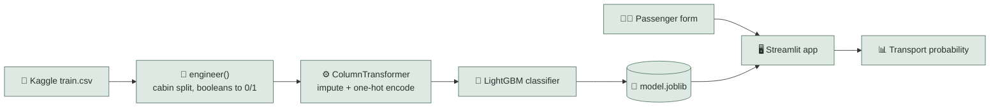

<div align="center">


<br/>

[](https://spaceship-titanic-vivesh.streamlit.app/)


**A machine-learning web app that predicts whether a passenger of the Spaceship Titanic was transported to another dimension.**

[**Try it live →**](https://spaceship-titanic-vivesh.streamlit.app/)

</div>

---

## ✨ About

In the year 2912, the *Spaceship Titanic* collided with a spacetime anomaly and almost half of its passengers were transported to an alternate dimension. This project turns the [Kaggle competition](https://www.kaggle.com/competitions/spaceship-titanic) data into an interactive tool: describe a passenger, and the model estimates the probability that they were transported.

It covers the full ML workflow end to end: feature engineering, a leak-free preprocessing pipeline, cross-validated model training, and a deployed web app.

## 🎯 Highlights

| | |
|---|---|
| 🧪 **Leak-free pipeline** | Imputation and one-hot encoding live inside a single scikit-learn `Pipeline`, so training and prediction use identical transformations |
| 🌲 **Gradient boosting** | LightGBM classifier, evaluated with 5-fold cross-validation |
| 🛰️ **Domain-aware inputs** | Passengers in cryosleep can't spend money, so the app sets their spending to 0 automatically |
| 🖥️ **Interactive UI** | Sidebar form, probability meter and a clear verdict, built with Streamlit |
| ☁️ **Deployed** | Hosted on Streamlit Community Cloud |

## 🧭 How it works



1. **Train (`train.py`)**: loads the Kaggle data, engineers features, runs 5-fold cross-validation, fits on all data and saves the pipeline to `model.joblib`.
2. **Serve (`app.py`)**: loads the saved pipeline once, turns the form inputs into a one-row DataFrame, and returns `predict_proba`.

## 🧬 Features used

| Group | Columns | Handling |
|---|---|---|
| Numeric | `Age`, `RoomService`, `FoodCourt`, `ShoppingMall`, `Spa`, `VRDeck` | Median imputation |
| Binary | `CryoSleep`, `VIP` | Mapped to 0/1, most-frequent imputation |
| Categorical | `HomePlanet`, `Destination`, `CabinDeck`, `CabinSide` | Most-frequent imputation, then one-hot encoding |

`CabinDeck` and `CabinSide` are split out of the raw `Cabin` string (`Deck/Num/Side`).

## 📈 Model

| | |
|---|---|
| Algorithm | LightGBM (`LGBMClassifier`) |
| Validation | 5-fold cross-validation |
| **CV accuracy** | **XX.X%** |

```python
model = Pipeline([
    ("prep", make_preprocessor()),
    ("clf", LGBMClassifier(random_state=42, verbose=-1)),
])
scores = cross_val_score(model, X, y, cv=5, scoring="accuracy")
```

## 🚀 Run it locally

```bash
git clone https://github.com/ranjanvivesh/Streamlit-Spaceshit_Titanic.git
cd Streamlit-Spaceshit_Titanic

python -m venv .venv
# Windows (PowerShell):  .venv\Scripts\Activate.ps1
# macOS / Linux:         source .venv/bin/activate

pip install -r requirements.txt
streamlit run app.py
```

### Retrain the model (optional)

The trained model is already included as `model.joblib`. To retrain it, download `train.csv` from the [competition page](https://www.kaggle.com/competitions/spaceship-titanic/data), put it in a `data/` folder, and run:

```bash
python train.py
```

> The dataset itself isn't redistributed in this repo, per Kaggle's competition terms.

## 🗂️ Project structure

```
├── app.py             # Streamlit app: inputs, prediction, results
├── features.py        # Feature engineering + preprocessing pipeline
├── train.py           # Cross-validation, training, saving the model
├── model.joblib       # Trained scikit-learn pipeline
└── requirements.txt   # Pinned dependencies
```

## 💡 What I learned

- **Keep preprocessing inside the pipeline.** Fitting imputers and encoders on training data only, and saving them with the model, removes any train/serve mismatch in the deployed app.
- **Raw columns in, features out.** The app builds a row with the same raw columns as the dataset, so one `engineer()` function serves both training and prediction.
- **Use domain rules where they exist.** Cryosleep passengers cannot spend money, which is both a strong signal and a sensible UI constraint.

## 🔭 Roadmap

- [ ] Add engineered features such as total spend and travel-group size
- [ ] Hyperparameter tuning with cross-validation
- [ ] Feature-importance / SHAP explanations in the app
- [ ] Data-insights tab with charts

## 🙏 Acknowledgements

Data from the [Spaceship Titanic](https://www.kaggle.com/competitions/spaceship-titanic) competition on Kaggle.

---

<div align="center">

Built by [**Vivesh**](https://github.com/ranjanvivesh) · If you like it, drop a ⭐


</div>
